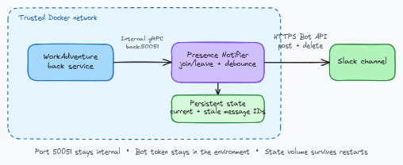

# workadventure-presence-notifier

[](https://github.com/Arata1202/workadventure-presence-notifier/actions/workflows/ci.yml)
[](https://github.com/Arata1202/workadventure-presence-notifier/releases/latest)
[](LICENSE)

A small service that maintains one event-driven Slack status for the people currently online in WorkAdventure.

## Architecture



The service discovers rooms and consumes presence events through WorkAdventure's internal gRPC API. It deduplicates users globally by WorkAdventure UUID, waits five seconds after the last change by default, then posts a new Slack message before deleting the previous one. Port `50051` stays inside the trusted Docker network; Slack calls use HTTPS. The editable diagram source is available in [Excalidraw format](docs/architecture/workadventure-presence-notifier.excalidraw).

Version 0.2 supports one WorkAdventure `back` service, one configured destination, and one notifier process.

## Behavior

- Publishes a synchronized non-empty snapshot on startup
- Debounces presence changes for five seconds by default
- Posts a changed non-empty status before deleting the previous status
- Deletes all known current and stale statuses when nobody is online
- Deletes all known current and stale statuses on intentional daemon shutdown
- Retains the last valid status while WorkAdventure discovery or room reconnection is incomplete
- Persists the destination ID, current message timestamp, and up to three known stale timestamps for restart replacement and cleanup

Example status:

```text
Currently online (3): Alice, Bob, Charlie
```

## Slack app setup

Create a Slack app with the `chat:write` bot token scope, install it to the workspace, and invite the bot to the target channel. For the existing text-only status, no event subscription, App-Level Token, channel-history scope, or Incoming Webhook is required.

Keep the bot token in the environment:

```sh
export SLACK_BOT_TOKEN="xoxb-..."
```

Never place the token in `config.yaml` or commit it.

## Quick start

The notifier must be able to reach the WorkAdventure `back` service on its internal Docker network.

```sh
cp config.example.yaml config.yaml
cp .env.example .env
# Set destination.slack.channel_id in config.yaml and fill in .env.

docker compose -f compose.example.yaml up -d --build
```

The named `notifier-state` volume preserves the destination ID and known message timestamps across restarts. The Compose example gives the process 20 seconds to finish its configured 10-second shutdown cleanup. Use `docker network ls` if the WorkAdventure network name is unknown.

## Configuration

Configuration files use Go duration syntax such as `30s`, `5m`, and `1h`. Unknown YAML keys are rejected.

```yaml
workadventure:
  address: "back:50051"
  room_discovery_interval: "30s"
  reconnect_interval: "5s"
  initial_sync_timeout: "2s"
  request_timeout: "10s"

status:
  debounce: "5s"
  shutdown_timeout: "10s"
  state_file: "/var/lib/workadventure-presence-notifier/state.json"

destination:
  slack:
    channel_id: "C0123456789"
    message: "Currently online ({{ .Count }}): {{ .Users }}"
    user_separator: ", "
    request_timeout: "10s"
```

Template values:

- `.Count`: total number of unique online users
- `.Users`: sorted, bounded, Slack-escaped display names joined with `user_separator`
- `.UserNames`: the bounded sorted display-name list

The service caps individual names, the rendered message, and Slack API response bodies. Requests have a configured timeout and bounded attempts. It sends plain text with Slack mrkdwn disabled, keeps `&`, `<`, and `>` escaped, and disables link and media unfurling.

## Office entrance button

Set a fixed office entrance URL to add a button below the presence text:

```yaml
workadventure:
  entrance_url: "https://office.example.invalid/entrance"
  entrance_label: "Open WorkAdventure" # optional default

destination:
  slack:
    # Other Slack settings are unchanged.
    interactions_listen: "127.0.0.1:8080" # default, only used with entrance_url
```

The URL is not a user-specific room or template. It must be an absolute HTTP(S)
URL without credentials, whitespace, or backslashes, at most 3000 characters.
Labels must contain non-whitespace text and be at most 75 characters. HTTPS is
recommended. Keep real office URLs and access secrets out of committed examples.
Omit `entrance_url` to retain the text-only payload, with no listener or signing
secret required.

The message uses plain-text sections followed by one URL button, with the original
`text` as its notification/accessibility fallback. Long text is split at Slack's
3000-character section limit without changing the existing 4000-character message
limit. Mrkdwn and link/media unfurling remain disabled.

### HTTP interaction setup

Slack [requires an acknowledgement even for URL buttons](https://docs.slack.dev/reference/block-kit/block-elements/button-element/).
Before enabling the button in a deployment:

1. Supply the existing Slack app's **Signing Secret** from **Basic Information**
   through `SLACK_SIGNING_SECRET`. This is not the bot token or an App-Level Token.
   It is required only when `entrance_url` is set; do not store it in YAML.
2. Configure the existing HTTPS reverse proxy to forward the exact path
   `/slack/interactions` to this notifier's HTTP listener, preserving the raw body
   and `X-Slack-Signature` / `X-Slack-Request-Timestamp` headers. For example,
   `https://office.example.invalid/slack/interactions` forwards to
   `http://127.0.0.1:8080/slack/interactions` when proxy and notifier share a host
   network namespace. TLS terminates at the proxy; the notifier does not serve TLS.
3. In the same Slack app's **Socket Mode** settings, turn **Enable Socket Mode**
   off so Slack uses HTTP instead of WebSocket delivery. If another integration
   uses Socket Mode on this app, coordinate the switch or use a separate Slack app.
   Then open **Interactivity & Shortcuts**, enable **Interactivity**, and save that
   HTTPS URL as the **Request URL**. Leave Options Load URL unused.
   No Events API subscription, challenge handler, Socket Mode, App-Level Token,
   or additional bot scope is needed for this button.
4. Start daemon mode and check a real click after deploying. Configuring the URL
   locally does not establish ingress or verify Slack reachability.

The default listener is loopback, not publicly bound. In Docker, a proxy in a
separate container cannot reach the notifier's loopback: explicitly set
`interactions_listen: "0.0.0.0:8080"` inside the notifier container and route the
proxy to `http://workadventure-presence-notifier:8080/slack/interactions` over a
trusted shared Docker network. Set `SLACK_SIGNING_SECRET` in `.env`; the Compose
example forwards it to the notifier and does not publish ports. Do not publish
the listener directly to the internet. Use an exact-path proxy rule rather than
redirecting WorkAdventure's other routes to the notifier.

Slack must reach this one route without interactive login/SSO middleware. Keep
WorkAdventure's own authentication unchanged: the callback authenticates Slack
requests, and does not authenticate users into the office or bypass office login.
Avoid request-body/header logging at the proxy because interaction payloads can
contain personal data and response URLs.

The receiver follows Slack's [request-signing contract](https://docs.slack.dev/authentication/verifying-requests-from-slack/):
HMAC-SHA256 over `v0:timestamp:raw_body`, constant-time signature comparison, and
a five-minute timestamp window (keep the host clock synchronized). It accepts only
POST requests to `/slack/interactions`, bounded to 1 MiB, with a form-encoded
`block_actions` payload containing the `open_workadventure` button action. It
returns an empty HTTP 200 without network calls or business actions, within
Slack's [three-second acknowledgement deadline](https://docs.slack.dev/interactivity/handling-user-interaction/).
Retries within the timestamp window receive the same harmless acknowledgement;
there is no per-request replay cache. Payloads and secrets are not logged.
Listener bind failures stop startup before publishing; receiver failures stop the
daemon and trigger normal status cleanup. The listener shuts down with the daemon.

Local tests cover signed callbacks and lifecycle with mocked requests. Live Slack
rendering/clicks, public HTTPS routing, and reverse-proxy authentication settings
must be verified in the target deployment; they are not established by these tests.

## Compatibility

The minimum supported version is WorkAdventure `v1.33.0`. End-to-end container tests have been completed against WorkAdventure `v1.33.0` and `v1.34.2`. Later releases may work when the required internal RPCs remain compatible, but untested versions are not guaranteed.

The provider uses the `getRooms` and `adminRoom` RPCs. The compatibility protocol includes only the fields required for presence; WorkAdventure IP address fields are discarded while decoding.

## Failure behavior

- Failed room discovery leaves the last valid global snapshot unchanged.
- A reconnect builds a replacement room snapshot privately and publishes it only after synchronization.
- A failed Slack post leaves the previous status and persisted reference unchanged.
- A missing persisted Slack message is treated as recoverable during delete or replacement.
- Startup stops with a clear error if persisted references belong to a different configured destination.
- Failed deletion of a known stale message is retained and retried on startup, publish, empty-state cleanup, and shutdown. The service stops posting replacements when all three stale slots remain occupied.
- Slack network failures after a post may be ambiguous. The service logs the failure and does not scan channel history or claim exactly-once delivery.
- Normal logs do not include user names, room URLs, tokens, or IP addresses.

## Migrating from v0.1

Version 0.2 replaces Incoming Webhooks and interval summaries. See [the v0.2 migration guide](docs/migration-v0.2.md) for Slack scopes, environment variables, configuration, persistence, and operational changes.

## Development

Requirements:

- Go 1.27.3 or later
- Docker, for container builds and protocol generation

Run the same validation used by CI:

```sh
test -z "$(gofmt -l .)"
go vet ./...
go test -race ./...
go run golang.org/x/vuln/cmd/govulncheck@v1.9.0 ./...
docker build --build-arg VERSION=ci -t workadventure-presence-notifier:ci .
test "$(docker run --rm workadventure-presence-notifier:ci --version)" = "ci"
```

Regenerate the minimal gRPC compatibility types with `make generate` after changing `proto/workadventure.proto`.

## Contributing and security

See [CONTRIBUTING.md](CONTRIBUTING.md) for contribution guidelines and [SECURITY.md](SECURITY.md) for private vulnerability reporting. Maintainers should follow [RELEASING.md](RELEASING.md) when publishing a version.

## License

This project is licensed under the MIT License. See [LICENSE](LICENSE).
